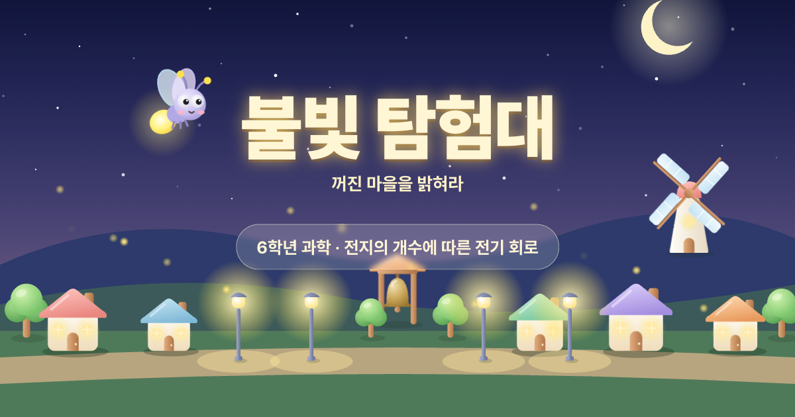
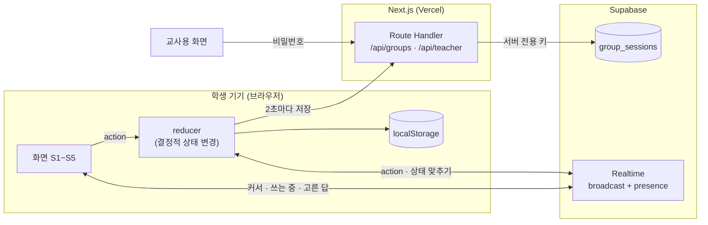

# 불빛 탐험대: 꺼진 마을을 밝혀라



초등학교 6학년 과학 「3. 전기의 이용」 4차시, 전지의 개수에 따른 전기 회로의 특징을 비교하는 **POE(예상 → 관찰 → 설명) 회로 시뮬레이션 게임**입니다.

- Service: https://light-explorers.vercel.app
- Teacher: https://light-explorers.vercel.app/teacher
- Guide: [docs/GAME_GUIDE.md](docs/GAME_GUIDE.md) — 게임 전체 설명서 (기능·흐름·설계 의도, 보고서용)

## 📖 프로젝트 소개

light-explorers는 학생 모둠이 "탐험대"가 되어 불이 꺼진 반짝마을을 돌아다니며, 전지 1개 회로(A)와 전지 2개 직렬 회로(B)를 직접 만들어 비교하는 웹 게임입니다. 성취기준은 [6과15-02] 전지의 개수에 따른 전기 회로의 특징 비교입니다. 설치 없이 태블릿·노트북 브라우저에서 바로 하고, 별도 API 서버 없이 Next.js Route Handler와 Supabase(DB, Realtime)로 기록과 모둠 동기화를 처리합니다.

- **혼자 하기** — 기기 1대로 이름만 쓰고 바로 시작합니다. 기록은 브라우저와 서버에 저장됩니다.
- **모둠으로 하기** — 선생님이 만든 모둠에 여러 기기가 들어와 한 화면을 실시간으로 함께 조작합니다. 고르는 문제는 모둠원 모두 같은 답이어야 정해지고, 마무리는 각자 합니다.
- **미션 3개** — 가로등(전구 밝기), 광장의 안내 종(버저 소리), 언덕의 풍차(전동기 빠르기)를 예상 → 만들기 → 비교 → 확인 순서로 해결합니다.
- **교사용 화면** — 모둠을 미리 만들고, 진행 상황과 학생별 기록, 고른 답 비율 통계를 10초마다 새로 봅니다.

## 🔄 Core Flow

### 1. 입장

**오프닝 → S1 입장 → 캐릭터 고르기**
- 혼자 하기(내 이름) 또는 모둠으로 하기(선생님이 만든 모둠 + 내 이름)
- 안전 약속 3가지를 모두 체크해야 시작
- 6가지 동물 탐험대 중 하나를 골라 지도와 친구 화면에 내 캐릭터로 표시

### 2. 도입

**S2 이야기 5장면**
- 빛 요정 반디가 꺼진 마을 상황을 알리고 도움을 요청
- 회로 조건 떠올리기, 전기 제품마다 전지 개수가 다른 까닭, 손 선풍기 바람 예상
- 학생 화면에는 정답을 보여 주지 않고 교사 기록에만 남김

### 3. 마을 탐험 · 미션

**S3 반짝마을 지도**
- 방향키·누르기·조이스틱으로 캐릭터를 움직여 가로등 → 광장 → 언덕 순서로 이동
- 모둠은 모두 장소에 모여야 미션 시작 (모이기, 모두 부르기)

**S4 미션 (전구 · 버저 · 전동기)**
- ① 예상: 보기 하나를 고르고 확정 (바꿀 수 없음)
- ② 만들기: A·B 회로판에서 전선을 잇고 스위치를 닫아 비교, 탐험 과제 3칸 자동 체크
- ③ 비교 · 생각 적기: ○표로 결과를 고르고 모둠의 생각을 적은 뒤 채점과 모범 답안 확인
- ④ 확인: 내 예상과 실제 결과, 장소가 되살아나고 마을이 밝아짐
- 막히면 5초 뒤 "힌트 보기" → 글 힌트 → 그래도 못 고치면 "시범 보기"로 작동할 때까지 회로판 위에서 안내

### 4. 마무리

**S5 마무리 5단계 + 축제 엔딩 (모둠도 각자)**
- 1\. 결과 모아 보기 → 2. 확인하기("직렬연결" 용어 처음 등장) → 3. 적용하기(전지 3개) → 4. 오개념 점검 → 5. 스스로 평가
- 퀴즈는 처음 고른 답만 기록하고 바로 정답·해설, 스스로 평가는 바꿀 수 있음
- 마치기를 누르면 마을 전체에 불이 켜지는 축제 엔딩

## 🗺️ Pages

| 경로 | 화면 |
|---|---|
| `/` | 학생 화면 (오프닝 → S1 입장 → 캐릭터 고르기 → S2 도입 → S3 지도 ⇄ S4 미션 → S5 마무리) |
| `/teacher` | 교사용 화면 (로그인, 한눈에 보기 · 모둠 진행 · 기록 · 모둠 관리 · 평가 기준) |

| API | 쓰임 |
|---|---|
| `GET /api/groups` | 선생님이 만든 모둠 목록 (학생 입장 화면) |
| `GET · PUT /api/groups/[id]` | 모둠 상태 불러오기 / 학습 기록 저장 |
| `GET · POST /api/teacher/groups` | 모둠 목록 · 만들기 (교사 비밀번호) |
| `DELETE /api/teacher/groups/[id]` | 모둠 지우기 (교사 비밀번호) |
| `GET /api/teacher/summary` | 교사용 집계 (교사 비밀번호) |

## 🛠️ Tech Stack

| Category | Stack |
|---|---|
| Framework | Next.js 16 (App Router), React 19 |
| Language | TypeScript |
| Styling | Tailwind CSS 4 |
| Graphics | SVG + CSS 애니메이션 (이미지 파일 · 이모지 없이 직접 그림) |
| Sound | Web Audio API (배경 음악 · 효과음 실시간 합성, 음원 파일 없음) |
| Backend | Supabase — PostgreSQL(`group_sessions` 표 하나), Realtime(broadcast + presence) |
| Test | Vitest (회로 판정, 단계 규칙, 동기화, 힌트 · 시범, 교사 통계 등 97개) |
| Deploy | Vercel |

## ✨ Key Features

### 1. 회로 시뮬레이터
- 단자를 끌거나 차례로 눌러 전선 잇기, 전선을 눌러 지우기, 스위치 열고 닫기
- 교과서 준비물 사진처럼 그린 부품 (파란 전지 끼우개, 꼬마전구, 연회색 버저, 초록 날개 전동기, 노란 스위치)
- 전선은 교과서처럼 빨강(전지 + 쪽) · 검정 두 색, 전지 · 버저 · 전동기 단자에 +, − 표시
- 그래프 분석으로 작동 레벨(0 · 1 · 2)과 막힌 이유(끊김, 합선, 같은 극, 버저 반대 등)를 판정하는 순수 함수 `judge()`

### 2. 관찰과 비교
- 전구 밝기 2단계, 버저 종소리 크기(A · B가 번갈아 울림), 전동기 빠르기와 도는 소리
- 미션 화면에서는 배경 음악을 꺼서 효과음을 비교하기 쉽게
- 어둡게 보기(미션 1)로 밝기 차이를 더 잘 보이게

### 3. 단계별 힌트
- 5초 멈추면 "힌트 보기" 버튼 → 상황별 글 힌트 8가지
- 5초 뒤에도 못 고치면 "시범 보기" → 지금 회로와 가장 적게 다른 정답을 찾아 지우기 → 잇기 → 스위치 순서로 끝까지 안내 (`circuit/nextFix.ts`)
- 지도서 288쪽대로 선 색의 뜻은 미리 알려 주지 않고, 버저가 안 울리면 양 끝 전선을 바꾸어 보게 함

### 4. 모둠 실시간 협업
- 한 명의 조작이 모든 기기에 바로 반영되는 공유 화면
- 모두 동의(고른 친구 색 동그라미), 모이기 · 모두 부르기 · 함께 가기
- 친구 커서, 친구가 끄는 전선, 회로판 조작 알림, 지도 위 친구 캐릭터
- 서술형 쓰는 중 잠금 (글자를 넣기 시작하면 잠그고, 칸을 벗어나거나 5초 쉬면 풀림)
- 늦게 들어온 기기 따라잡기, 15초마다 상태 맞추기, 새로고침 후 같은 모둠으로 다시 들어가기

### 5. 교사용 화면
- 한눈에 보기: 미션 · 마무리 완료 숫자 카드, 미션 예상과 마무리 퀴즈를 고른 답 비율로 나눈 막대
- 모둠 진행: 마지막 활동, 지금 위치, 완료한 미션, 힌트 / 시도 횟수
- 기록: 모둠 기록(도입 표 · 미션 표), 개인 마무리 기록 (맞은 칸 연한 초록, 틀린 칸 연한 빨강)
- 모둠 관리(1~12모둠 만들기 · 지우기), 평가 기준(지도서 평가 요소 · 근거)

### 6. 사용성 · 접근성 · 안전
- 손가락으로 누르기 쉬운 44px 이상 버튼, 한 화면에 한 가지 할 일
- 색만으로 알리지 않고 ✓ · ✗, +, − 글자, 이름 첫 글자를 함께 표시
- 안전 약속 체크와 미션 화면 아래 안전 문구
- 학생에게 받는 정보는 화면에 보일 이름 하나뿐

## 🏛️ Architecture



- **상태 변경은 reducer 하나로** — 모든 게임 상태 변화는 결정적 reducer에서만 일어납니다. 시각 · id는 action에 담아 보내서, 같은 action을 모둠의 모든 기기에 보내면 화면이 똑같아집니다.
- **두 층 동기화** — 공유 기록(회로 · 답 · 단계)은 action으로 보내고 저장합니다. 실시간 존재감(커서 · 캐릭터 · 쓰는 중 · 고른 답)은 저장하지 않는 가벼운 메시지로 따로 보냅니다.
- **판정은 순수 함수** — 회로 판정과 단계 진행 조건은 화면과 분리된 함수라 테스트로 검증하고, reducer와 화면이 같은 함수를 씁니다.
- **보안** — 서버 전용 키는 브라우저로 보내지 않고, DB는 RLS로 브라우저 직접 접근을 막았습니다. 교사 API는 비밀번호로 보호합니다.

## 📂 Project Structure

```
src/
  app/
    page.tsx                  # 학생 화면
    teacher/                  # 교사용 화면 (page, layout, 아이콘, 링크 미리보기 이미지)
    api/                      # Route Handler (모둠 목록 · 상태 저장 · 교사 집계)
    opengraph-image.png       # 링크 미리보기 이미지
  components/
    StudentApp.tsx            # 학생 앱 뼈대 (상태 · 모둠 연결 · 실시간 존재감 · 소리)
    screens/                  # 오프닝, S1 입장 ~ S5 마무리, 캐릭터 고르기
    circuit/                  # SVG 회로판, 힌트 타이머
    mission/                  # 미션 이야기 창, 학습지 (단계별 패널 · 축하 · 도전)
    village/                  # 마을 · 캐릭터 · 물건 그림, 돌아다니기, 상황 장면
    SharedTextArea.tsx        # 쓰는 중 잠금이 있는 서술형 칸
    GroupChoice.tsx           # 모두 동의
    LiveCursors.tsx           # 친구 커서
    ui.tsx                    # 버튼 · 선택지 · 확인 창 · 말풍선 등 공통 부품
  lib/
    circuit/                  # ★ 회로 판정(judge), 힌트 규칙(hints), 시범 단계 찾기(nextFix)
    flow/                     # 미션 · 도입 · 마무리 단계 진행 규칙, 도전 단계
    store/                    # ★ reducer, action, 상태 Context, 브라우저 저장
    sync/                     # 서버 저장, 모둠 동기화, Realtime 통로, 실시간 존재감
    teacher/                  # 교사용 집계 · 통계, 모둠 만들기, 비밀번호 확인
    tutorial/                 # 회로 만들기 튜토리얼 단계
    world/                    # 마을 돌아다니기 계산 (걷기 · 조이스틱 · 도착 판정)
  data/
    strings.ts                # 화면 문구 전부 (문구는 이 파일만 고치면 됨)
    missions.ts               # 미션 3개 설정 · 내부 정답
    boards.ts                 # 회로판 A/B 부품 위치 · 단자
    world.ts                  # 반짝마을 지도 배치
  media/                      # 배경 음악 · 효과음 (Web Audio 합성)
supabase/
  schema.sql                  # DB 스키마 (group_sessions 표 하나, RLS)
docs/
  GAME_GUIDE.md               # 게임 전체 설명서 (보고서용)
```

## 🚀 Getting Started

```bash
npm install
npm run dev          # http://localhost:3000
npm test             # 단위 테스트
npm run typecheck
npm run lint
npm run build && npm start
```

같은 와이파이의 다른 기기에서는 `http://<이 컴퓨터 IP>:<포트>`로 들어옵니다. 개발 서버(`next dev`)는 다른 기기에서 일부 파일이 막힐 수 있어서, 여러 기기 시험은 `npm run build && npx next start -p 3200`처럼 빌드한 서버로 합니다.

### 환경 변수

`.env.example`을 `.env.local`로 복사해 채웁니다. (`.env.local`은 git에 올리지 않습니다)

| 변수 | 쓰임 | 없으면 |
|---|---|---|
| `NEXT_PUBLIC_SUPABASE_URL` | Supabase 주소 | 1단계 모드 |
| `NEXT_PUBLIC_SUPABASE_PUBLISHABLE_KEY` | 브라우저용 키 (실시간 동기화) | "모둠으로 하기"가 보이지 않음 |
| `SUPABASE_SECRET_KEY` | 서버 전용 키 (DB 읽기 · 쓰기). **절대 `NEXT_PUBLIC_`을 붙이지 않음** | 서버 저장 · 교사 화면 · 모둠 목록이 꺼짐 |
| `NEXT_PUBLIC_REMOTE_SAVE` | `true`면 학습 기록을 2초마다 서버에 저장 | 브라우저에만 저장 |
| `TEACHER_PIN` | 교사용 화면(`/teacher`) 비밀번호 | 교사 화면이 열리지 않음 |

DB는 `supabase/schema.sql`을 Supabase SQL Editor에서 한 번 실행합니다.

| 단계 | 필요한 설정 | 되는 것 |
|---|---|---|
| 1단계 | 없음 | 혼자 하기, 기록은 브라우저에만 |
| 2단계 | Supabase 주소 + 서버 키 + 저장 켜기 + 교사 비밀번호 | 서버 저장, 교사용 화면 |
| 3단계 | + 브라우저용 키 | 선생님이 만든 모둠에서 여러 기기가 실시간으로 함께 |

## 📌 정해 둔 동작

명세서에 없거나 팀 요청으로 바꾼 것입니다. 자세한 내용은 [게임 설명서](docs/GAME_GUIDE.md)에 있습니다.

| 상황 | 정한 동작 |
|---|---|
| 힌트 | 저절로 뜨지 않음. 5초 뒤 "힌트 보기" → 글 힌트 → 5초 뒤 "시범 보기" |
| "스위치가 열려 있어요" 힌트 | 연결이 맞고 스위치만 열린 채 5초가 지나면 표시 (명세서의 "스위치를 닫고 5초"와 모순이라) |
| B 회로에 전지 1개만 이은 고리 | 작동(레벨 1)하지만 탐험 과제 2번은 체크하지 않고, 전지 2개를 모두 이으라는 힌트 |
| 버저 선 색 | 선 색의 뜻은 미리 알려 주지 않음 (지도서 288쪽). 거꾸로 이으면 "종이 울리지 않아요."만 표시 |
| 미션 ③ 생각 적기 | 글자 수 제한 없음 (10글자 제한은 6학년에게 부담이라 뺌). 확인하기를 누르면 바로 채점 · 모범 답안, 이후 고칠 수 없음 |
| 처음 고른 답만 기록 | 회로 조건 떠올리기, 마무리 확인하기 · 적용하기 · 오개념 점검. 스스로 평가는 바꿀 수 있음 |
| 마무리 단계 | 5단계 + 마치기(번호 없음, 화면에 1/5~5/5). 생각 정리 빈칸 쓰기는 확인하기와 겹쳐서 뺌 |
| 지도로 돌아가기 · 나가기 | 언제든 가능. 나가기는 이 기기 기록만 지우고 서버 기록은 남김 |
| 배경 음악 | 미션 화면에서는 꺼짐 (효과음 비교를 위해) |
| 세계관 | 3차시 책 이야기와 잇지 않음. 주인공은 탐험대, 무대는 반짝마을, 안내는 빛 요정 반디 |
| 교사용 평가 기준(상 · 중 · 하) | 명세서로 만든 **임시 문장** (`data/strings.ts` `TEACHER.rubric`) |

## ✅ 남은 일

- [ ] 교사용 평가 기준(상 · 중 · 하)을 지도서 문장으로 교체
- [ ] 태블릿 실기기에서 글자 · 버튼 크기, 움직임, 마무리가 7분 안에 끝나는지 확인
- [ ] 여러 모둠이 동시에 접속하는 실제 수업 규모로 시연 (실시간 메시지 양 확인)
